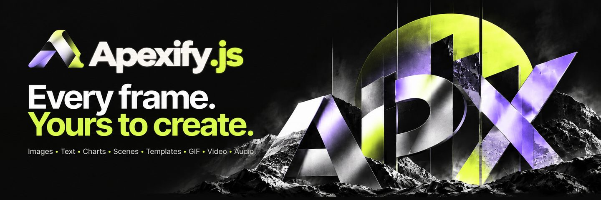

<p align="center">
  
</p>

# Apexify.js Documentation

This repository powers the Apexify.js documentation website and developer portal.

- **Website:** https://apexifyjs.vercel.app
- **Package repository:** https://github.com/EIAS79/Apexify.js
- **Documentation:** https://apexifyjs.vercel.app/docs/getting-started
- **API reference:** https://apexifyjs.vercel.app/api-reference
- **Gallery:** https://apexifyjs.vercel.app/gallery
- **Studio:** https://apexifyjs.vercel.app/studio


## Documentation program status

**DOC-0 through DOC-12 are complete as project phases.**

See [DOC0_12_PROGRAM_COMPLETION_STATUS.md](./DOC0_12_PROGRAM_COMPLETION_STATUS.md) for the authoritative current program status. Historical phase reports and CI logs remain preserved as historical evidence.

## Brand assets

The current brand assets live in `public/brand/`:

- `apexify-lockup-v2.avif` — approved transparent logo + wordmark (homepage, docs, and Studio).
- `apexify-icon-v2.avif` — approved app/brand icon for reusable UI components.
- `apexify-favicon-v2.png` — simplified browser-tab favicon.
- `apexify-npm-banner-v2.jpg` — cinematic README and npm banner.
- `apexify-banner-v2.avif` — optimized wide banner.
- `apexify-social-v2.jpg` — 1200 × 630 social-sharing image.
- `app/apple-icon.png` — Apple touch icon matching the new mark.

Previous brand media remains in Git history and existing files as a fallback. New UI surfaces use the v2 assets to prevent stale cached logos.

## Development

```bash
npm install
npm run dev
```

For the complete documentation verification pipeline:

```bash
npm run verify
```

The site is built with Next.js and the documentation system is validated against the pinned Apexify.js package artifact.
