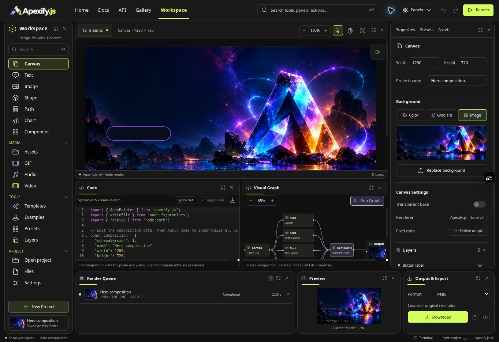
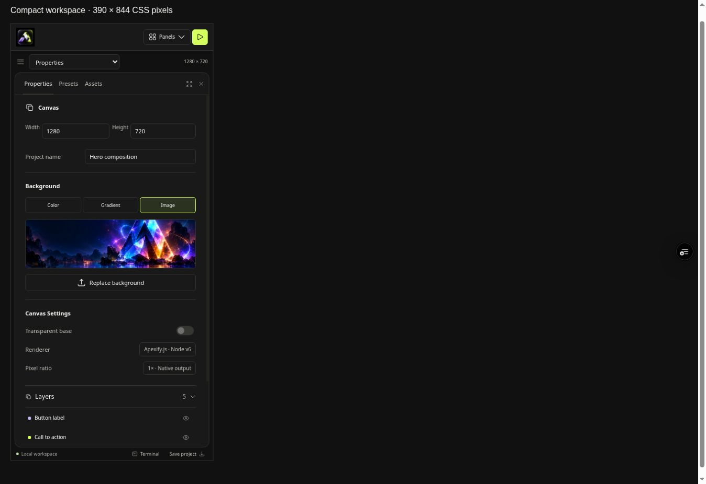

# Workspace branding alignment — 2026-10-19

The workspace now uses the Frame homepage and gallery palette: `#111111` charcoal, `#191919` panels, `#f2f2ef` text, `#d5ff5f` lime, and `#c4b5ef` lilac. `BrandBanner` supplies the exact site wordmark on desktop; `BrandIcon` supplies the compact header and empty-workspace icon. The site favicon remains inherited. UI tokens do not alter composition data, artwork, or exported document colors.

## Verification

- Scoped TypeScript check for `features/apex-workspace/WorkspaceApp.tsx`: passed, including its graph and shared Brand component dependencies.
- PostCSS parsing and custom-property reference validation: passed; every referenced workspace token is defined.
- `git diff --check`: passed.
- All six existing workspace contract tests: passed.
- Existing runtime parity test: passed; downloaded public-v6 source and server renderer produce identical pixels.
- React review: no added state, network waterfall, event listener, or rendering side effect; graph CSS tokens are read once per drawing effect; existing controls and accessible names retained.
- Neutral muted text / panel contrast: 6.95:1. Primary action label / lime background: 14.72:1. Lilac / secondary graph surface: 7.28:1.
- Exact workspace source and canonical assets built successfully in an isolated Next.js production fixture and deployed as a preview. This fixture substitutes a minimal root layout and excludes the unrelated documentation/Studio installation steps.
- Browser verification in that fixture: both canonical brand assets loaded; charcoal and lime computed styles match; no document horizontal overflow; live render and queue completed; panel close/reopen reclaims/restores space; high-contrast mode uses brighter neutral borders; desktop logo remains readable.
- Compact verification: a same-origin 390 × 844 CSS-pixel iframe displays the canonical icon and usable controls; switching from Visual Canvas to Properties works. This is a CSS viewport check, not physical-device certification.

## Deployment limitation

Two full-repository Vercel preview attempts failed before application compilation in the existing `scripts/studio/install-ffmpeg.mjs` postinstall download: “Client network socket disconnected before secure TLS connection was established.” No deployment configuration, runtime pin, or installer was changed for this theme work. Successful isolated workspace compilation and browser checks do not certify the full site's production deployment. The full-site FFmpeg download remains a separate deployment blocker.

## Evidence

