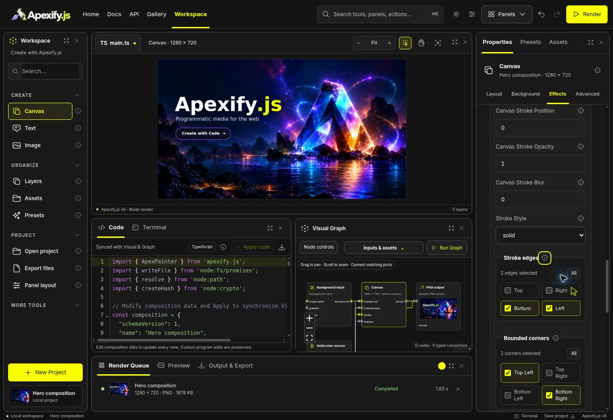
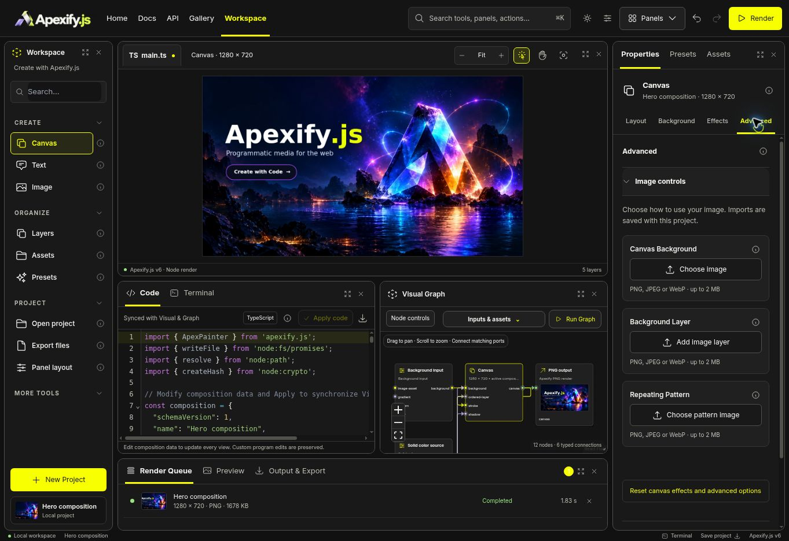
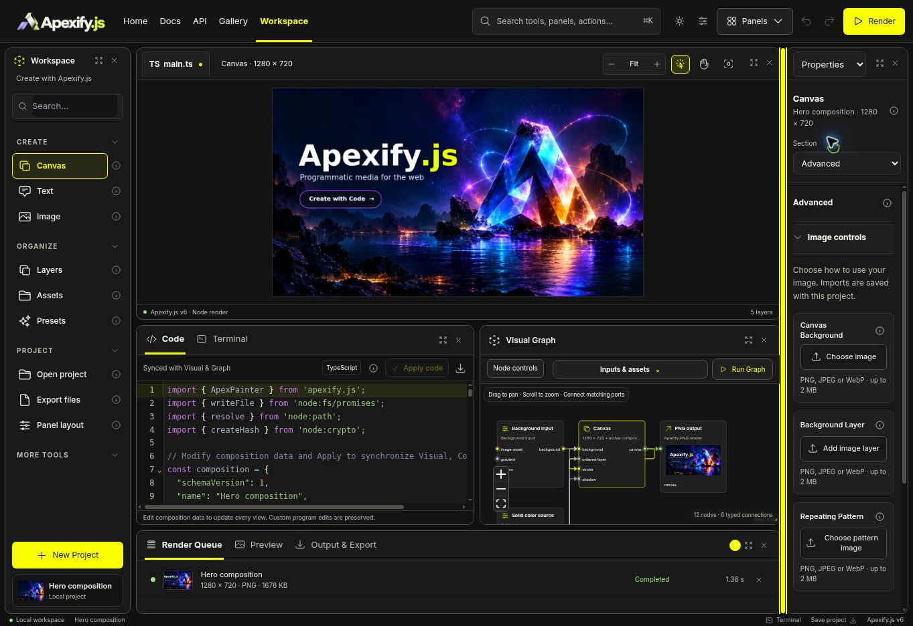

# Inspector controls repair — 2026-10-28

The reported Advanced image imports exposed browser file buttons that overlapped in narrow docks. Stroke sides and corner selectors also allowed only one value even though the pinned native renderer accepts combinations.

## Result

- Replaced visible native file inputs with a shared, keyboard-accessible upload button, filename/type/size guidance, loading state, and inline import errors. Used for Canvas background/layers/patterns, Image replacement, and Image/Group masks.
- Used independent edge and corner checkboxes across Canvas, Image, Group, and Graph controls. Bottom + Left and Top + Right + Left are supported. All restores the complete selection; shadow controls retain inheritance and the deprecated alias under Compatibility settings.
- Validated comma-separated combinations throughout project import, generated source, and native rendering. Existing single-value aliases remain accepted. At least one choice stays selected; disable a stroke or set radius to zero to remove the corresponding treatment.
- Corrected shadow-radius availability so an explicit zero radius overrides a positive owning Canvas radius. Image shadow help reflects the native API's separate shadow geometry.
- Prevented headers/tabs from shrinking as content grows. Compact docks use labeled navigation selects. Reduced nested form padding and stacked controls at narrow widths; image background controls also stack correctly.
- Category changes start at the top of their content, rather than retaining the previous category's scroll position. Rendering metadata uses a readable definition list.

## Verification

- TypeScript and `git diff --check` passed.
- 1,018 tests passed across border combinations, native Canvas stroke sides/shadows, Canvas authoring, Image implementation, model/domain contracts, Text native behavior, and background controls.
- Nine additional Inspector-surface/accessibility checks passed. All 330 Image option identities retain a reachable control or the existing explicit external/container classification.
- Eight new combination tests are included in the 1,018: every nonempty token subset validates; malformed input fails; requested edge combinations and legacy aliases behave correctly; Canvas/Image/Group values survive source/v2 round trips; native pixels prove the selected edges and diagonal corners; generated programs produce identical PNG bytes.
- Cloud Chromium checked independent edge/corner changes, positive stroke radius, persistence after reload, help/Escape, keyboard splitter resizing, category scroll reset, and light/dark themes. At approximately 181px and 296px inspector widths, import views had equal scroll/client widths (no horizontal overflow).
- Screenshots below show the actual app, without interface overlays or generated UI.

## Screenshots

## Limits

This patch repairs the reported controls and preserves the selected Workspace layout. It does not certify every Workspace feature. Successful file upload still requires a secure browser context (HTTPS or localhost); this HTTP preview does not provide Web Crypto. No successful end-to-end upload is claimed in this pass. Historical browser probes written for single-choice selects were not executed. Full-site prerender/search blockers recorded in the parent PR remain outside this patch; it stays draft, unmerged, and undeployed.
