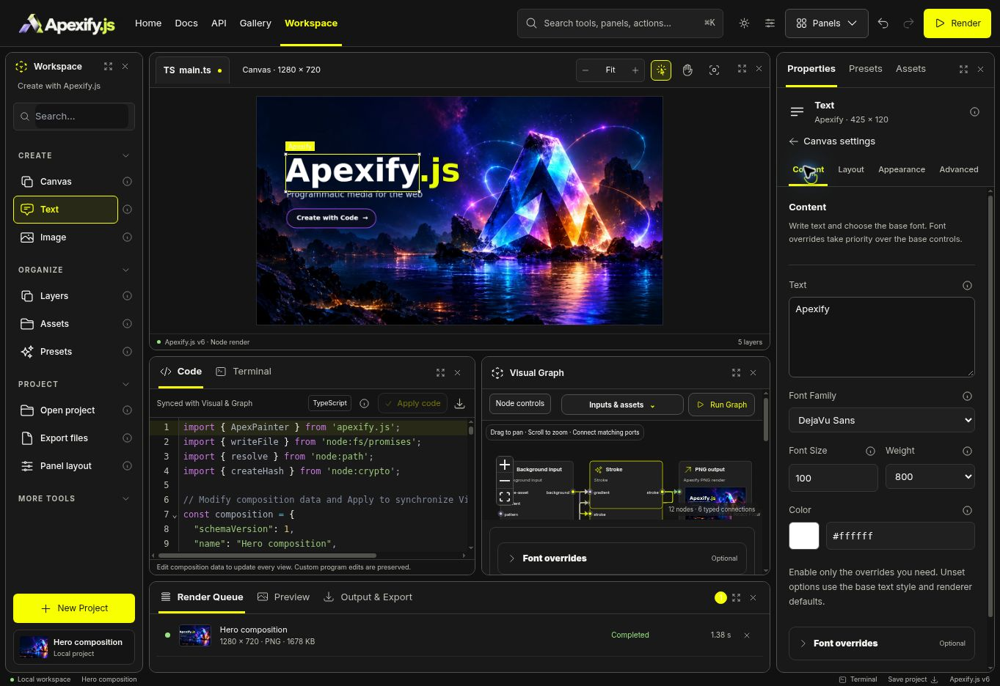
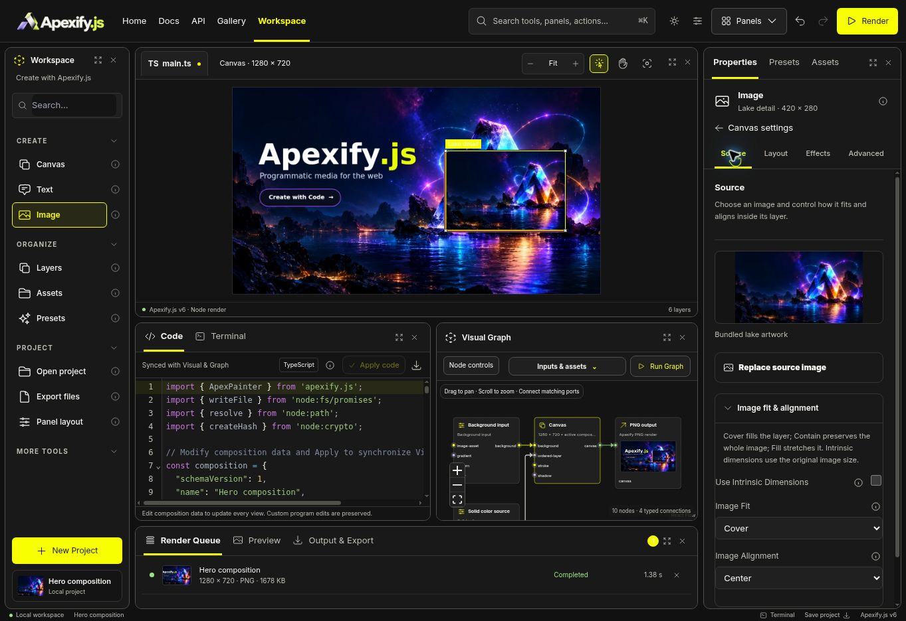
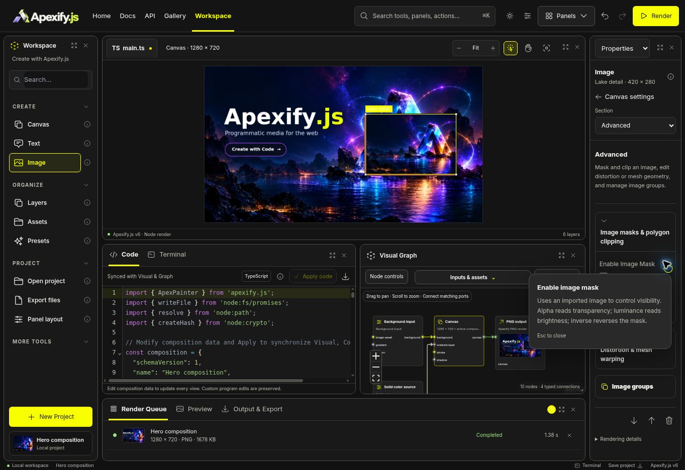

# Text and Image inspector refresh — 2026-10-28

Applies the existing Canvas inspector design to Text and Image. The previous inspectors put transforms and long advanced forms in one scroll. The new navigation keeps common editing visible and groups advanced controls by purpose.

| Section | Text | Image |
| --- | --- | --- |
| Primary | Content, font family, size, weight, color and font overrides | Source preview, replace/upload disclosure, fit and alignment |
| Layout | Position, selection bounds, rotation, opacity, spacing, wrapping and alignment | Position, dimensions, rotation, opacity and selected rounded corners |
| Appearance / Effects | Fill, outlines, decorations, highlight, glow and shadow | Blur, compositing, stroke/shadow/box paint, ordered filters and photographic effects |
| Advanced | Curved text, runs/groups, measurement options and native metrics | Masks, polygon clipping, distortion, mesh warp and image groups |

The panels reuse Canvas colors, spacing, contextual help and keyboard tab navigation. A Canvas settings shortcut returns to canvas properties. Narrow docks replace the tab strip with a labeled section selector. Section changes reset the scroll position, and selecting a different layer starts on its primary view.

A direct installed-font selector and visible color swatch/hex field improve Text's basic controls. Existing configured font/fill overrides are identified so their precedence is visible. Image's source replacement controls are collapsible to keep fit/alignment visible. Intrinsic-size mode disables ignored fit/alignment controls. Existing multiple-edge/corner selections are preserved. Image groups explain the native requirement for at least two adjacent visible Image/Shape members.

No document schema, native renderer, code generator, or project artwork changed. Text and Image editors default to the complete control set outside the main inspector, preserving Graph use. Every text property family is explicitly mapped to a category. New reachability tests compare the union of focused controls with the full editors; the existing 330 Image identities retain authoring surfaces or their existing external/container classification.

## Validation

- TypeScript and whitespace checks passed.
- **51 tests passed:** six new category/reachability/navigation cases, Image Inspector coverage, native Text and Image rendering, exact generated-program PNG parity, multi-edge/corner behavior, model/domain round trips and native text-metrics stream validation.
- Real browser verification: Text family change visibly reached the native canvas; Undo restored it. Advanced measurement returned native bounds. Image fit and intrinsic mode responded correctly, and Image strokes retained Bottom + Left selection. Arrow-key navigation moved Effects to Advanced. Narrow section selectors and help/Escape worked. Light and dark themes remained readable. Approximately 181px and 296px docks were checked; narrow views had at most one pixel of horizontal rounding overflow.
- Original composition was exported before using a bundled-image review fixture, then restored. The Image screenshots use that explicit review fixture; they show actual native output, not a generated mockup.

## Screenshots

## Release scope

This update remains in the existing draft PR, unmerged and undeployed. The previously documented full-site release blockers and HTTPS image-upload verification remain outside this UI pass. Local JSON project import/export was exercised; successful image-file import in this HTTP preview is not claimed. Historical browser probes that target the old flat inspector were not rerun.
